<div align="center">

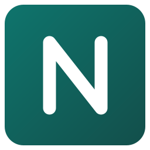

# NextData

**Il tuo storage remoto, ovunque tu sia. Un solo client per SFTP, WebDAV e S3 — su Windows e Android.**

Sicuro per progetto, nativo nell'esperienza, scritto in Rust e Kotlin.

[](https://github.com/andreareale07/nextdata/releases)
[](https://github.com/andreareale07/nextdata/actions/workflows/ci.yml)
[](LICENSE)


[**Scarica**](https://github.com/andreareale07/nextdata/releases/latest) ·
[Funzionalità](#funzionalità) ·
[Sicurezza](#sicurezza) ·
[Architettura](#architettura) ·
[Compilare dai sorgenti](#compilare-dai-sorgenti) ·
[Contribuire](CONTRIBUTING.md)

<br>

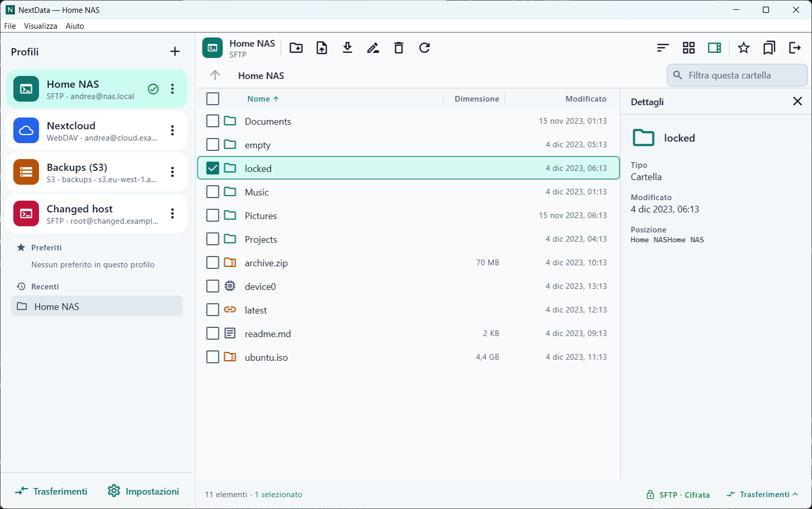

</div>

---

## In breve

NextData è un client di storage remoto pensato per chi gestisce file su server propri e cloud diversi e non vuole
un'app per ogni protocollo. Si configura un profilo, si accetta l'impronta del server una volta sola, e si lavora come
in un file manager: navigare, caricare, scaricare, rinominare, eliminare, con coda di trasferimenti e ripresa dopo
una perdita di rete.

| | |
|---|---|
| **Protocolli** | SFTP · WebDAV (es. Nextcloud) · S3 e compatibili (AWS, MinIO, Backblaze…) |
| **Piattaforme** | Windows 10/11 (x64) · Android 8.0+ (API 26) |
| **Lingue** | Italiano · English (cambio lingua dentro l'app) |
| **Temi** | Chiaro · Scuro · Segue il sistema |
| **Stato** | **Beta** — usabile, ma ancora in fase di collaudo |

## Screenshot

<table>
  <tr>
    <td align="center">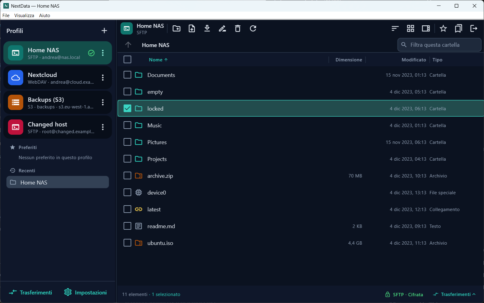<br><sub>Desktop · tema scuro, tre zone: profili, cartelle, dettagli</sub></td>
    <td align="center">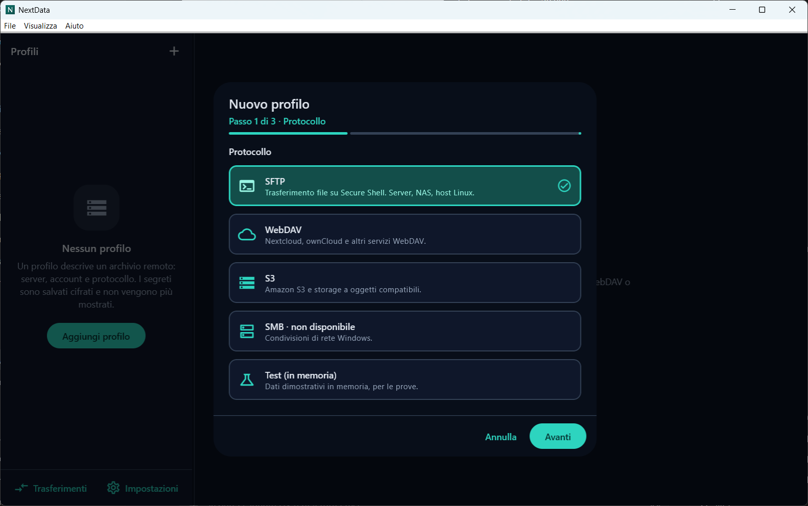<br><sub>Creazione profilo guidata, con validazione in tempo reale</sub></td>
  </tr>
  <tr>
    <td align="center">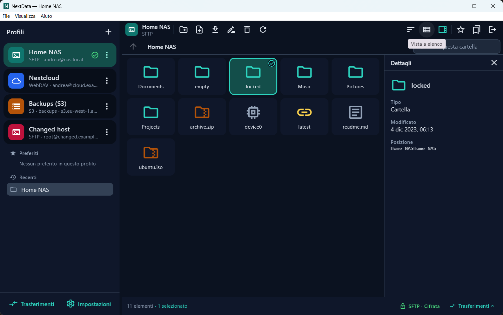<br><sub>Vista elenco o griglia, filtro rapido, scorciatoie da tastiera</sub></td>
    <td align="center">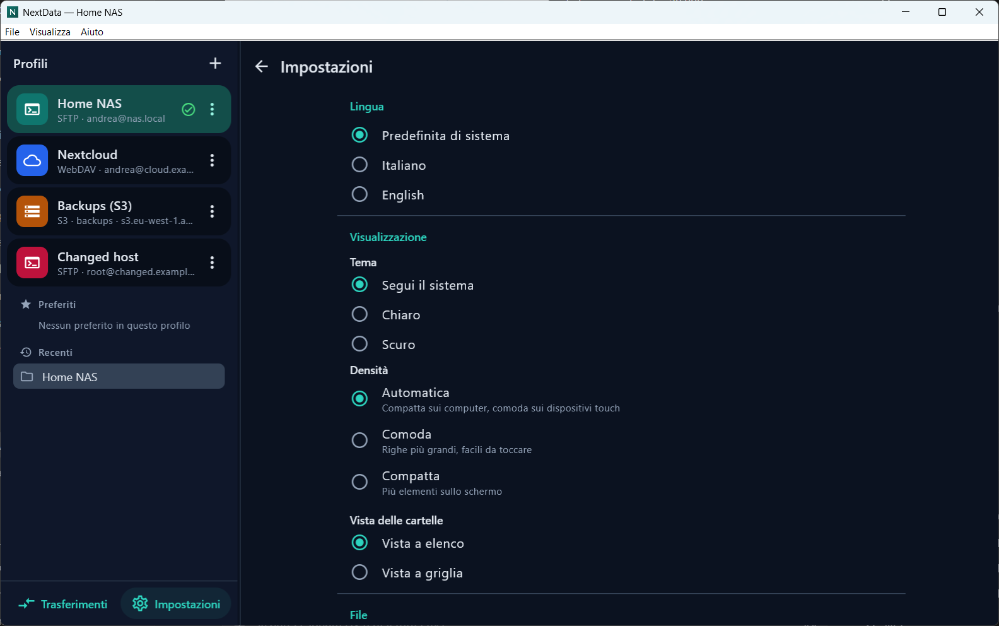<br><sub>Impostazioni: lingua, tema, densità, conflitti di nome</sub></td>
  </tr>
</table>

<table>
  <tr>
    <td align="center">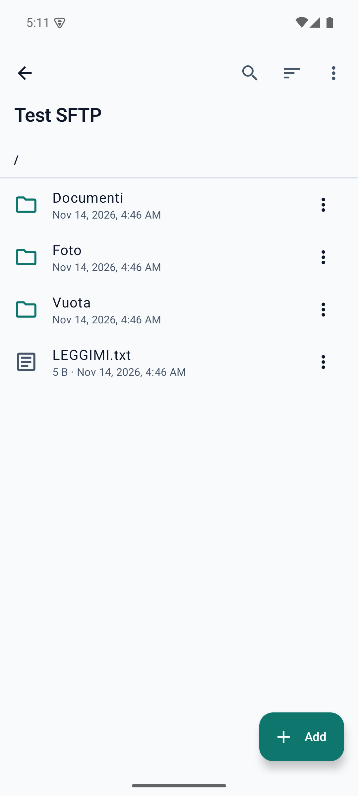<br><sub>Android · chiaro</sub></td>
    <td align="center">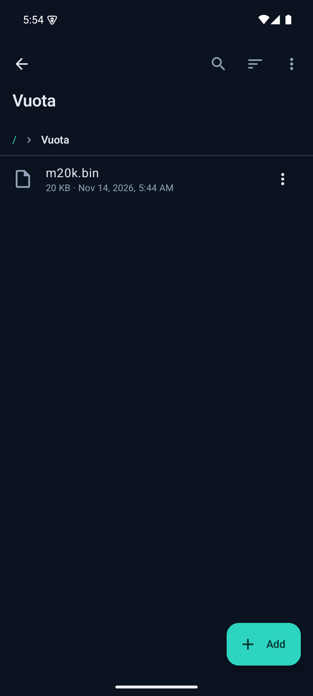<br><sub>Android · scuro</sub></td>
    <td align="center">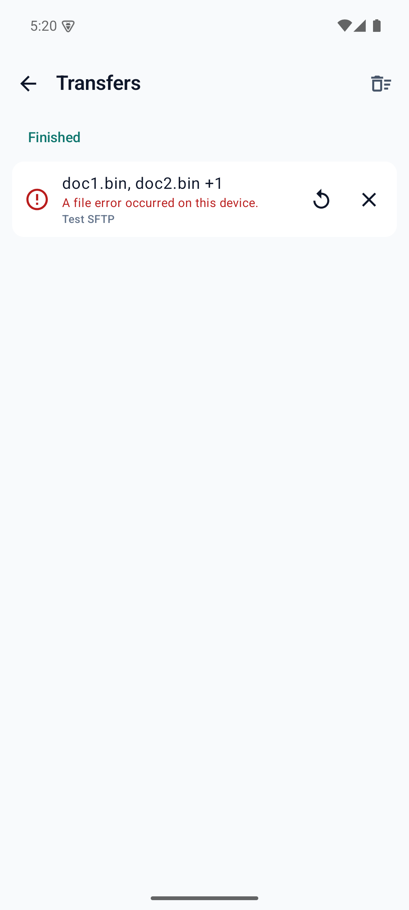<br><sub>Trasferimenti con velocità e ETA</sub></td>
    <td align="center">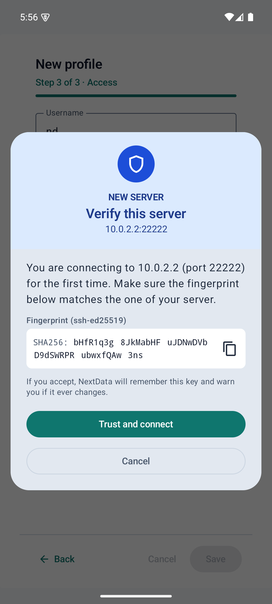<br><sub>Verifica dell'impronta del server</sub></td>
  </tr>
</table>

### Apri, guarda e modifica senza scaricare

Un tocco (o un doppio clic) apre il file così com'è sul server: niente più scarica → modifica → ricarica.

<table>
  <tr>
    <td align="center">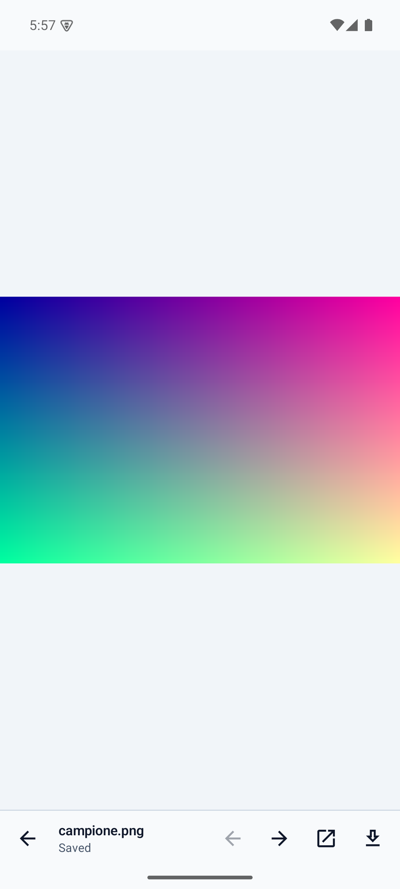<br><sub>Immagini, con zoom e scorrimento</sub></td>
    <td align="center">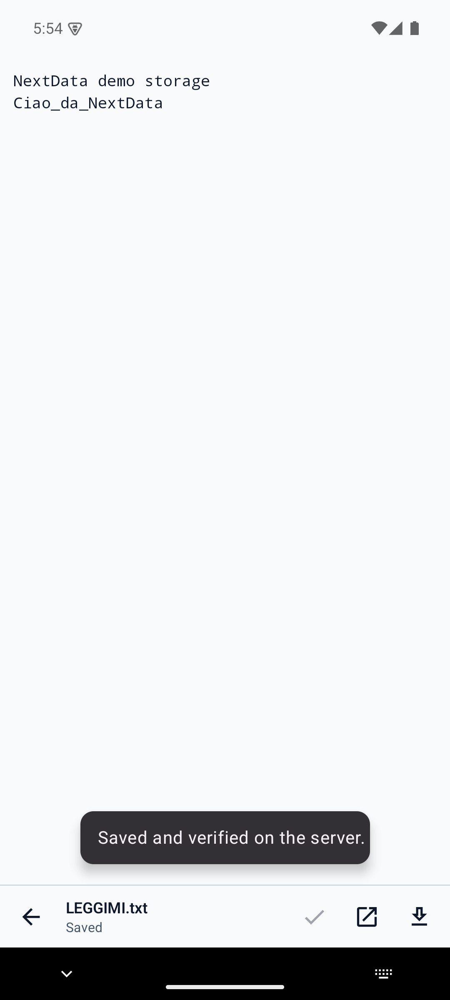<br><sub>Testo modificabile, «Salvato e verificato»</sub></td>
    <td align="center">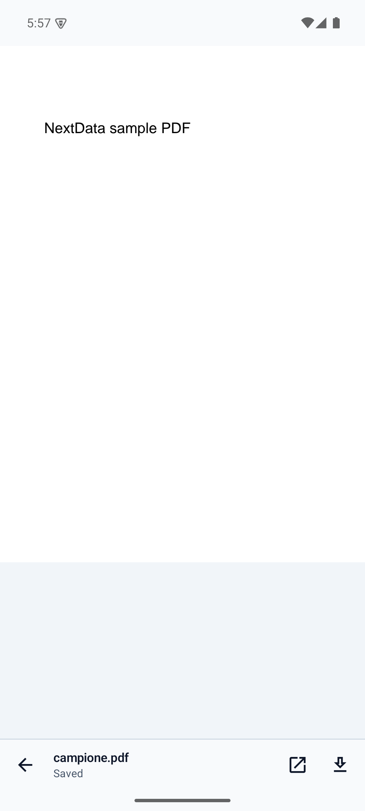<br><sub>PDF (Android)</sub></td>
    <td align="center">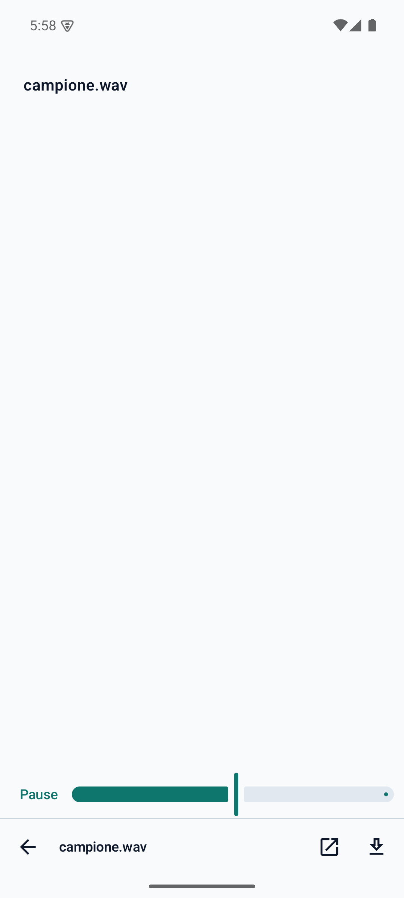<br><sub>Audio e video dal server, senza copiarli (Android)</sub></td>
    <td align="center">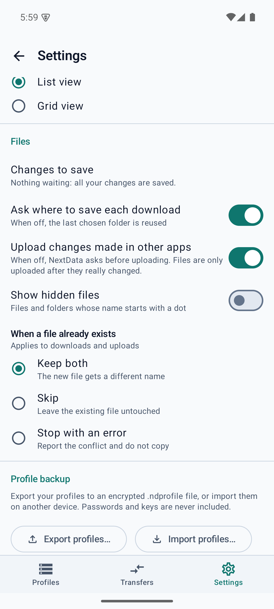<br><sub>Modifiche da salvare e salvataggio delle altre app</sub></td>
  </tr>
</table>

- **Visualizzatori interni**: immagini, testo/codice/CSV/JSON (con editor), PDF e audio/video su Android. Su Windows PDF e video si aprono con l'app di sistema.
- **Altri formati**: si aprono con l'app che preferisci; NextData controlla il contenuto del file e, se è davvero cambiato, lo carica sul server e **verifica** che sia arrivato prima di dire «salvato». Se l'app salva altrove, puoi importare la versione modificata.
- **Niente perdite**: se il file sul server è cambiato nel frattempo scegli tra salvare come copia, sovrascrivere (con doppia conferma) o annullare. Le modifiche non ancora salvate restano al sicuro sul dispositivo e le ritrovi in *Impostazioni → Modifiche da salvare*, anche dopo un arresto improvviso.
- **Onestà sui limiti**: il salvataggio automatico dipende dall'app esterna; dove non è garantibile NextData lo dice. Stato dei collaudi, rischi e cose non ancora verificate (SMB reale, video, app esterne reali): [docs/open-edit-compat.md](docs/open-edit-compat.md).

## Funzionalità

**Un client, tre protocolli**
- SFTP con autenticazione a password o chiave privata (con passphrase)
- WebDAV su HTTPS, compatibile con Nextcloud e simili
- S3 e servizi compatibili, con endpoint personalizzato
- Profili salvati e riutilizzabili, con importazione/esportazione cifrata (`.ndprofile`, mai con le credenziali)

**Esperienza di lavoro**
- Navigazione a breadcrumb, ordinamento per nome/dimensione/data, filtro rapido nella cartella
- Operazioni complete: nuova cartella, rinomina, elimina (anche ricorsiva), carica e scarica file e cartelle intere
- Coda di trasferimenti (2 in parallelo) con avanzamento, velocità, tempo stimato, pausa, annulla e riprova
- Preferiti, recenti e ripristino dell'ultima cartella visitata
- Windows: layout a tre zone, menu contestuale, colonne ridimensionabili, selezione multipla, drag & drop
- Android: layout adattivo telefono/tablet, accesso ai file tramite Storage Access Framework, servizio in primo piano per i trasferimenti, riconnessione automatica dopo la sospensione dell'app
- Accessibilità: scala dei font fino al 200%, contrasti curati, tema scuro vero

## Sicurezza

La sicurezza non è un livello aggiunto in fondo: è il motivo per cui il motore è separato dall'interfaccia.

- **Trust on first use verificato.** Nessuna credenziale viene inviata prima che l'utente abbia accettato l'impronta del server (SSH) o il certificato (TLS, con pin SPKI). Se l'impronta *cambia*, la connessione è bloccata e la sostituzione richiede una conferma esplicita.
- **Solo crittografia moderna.** I server SSH che offrono soltanto algoritmi deboli (SHA-1, CBC, `ssh-rsa`) vengono rifiutati.
- **Segreti cifrati a riposo.** Lo store dei profili usa ChaCha20-Poly1305; la chiave è avvolta dal Keystore di Android o da DPAPI su Windows. Nessun segreto compare in chiaro nei dati dell'app o nei log.
- **Difese contro server ostili.** Percorsi con traversal, nomi riservati di Windows, XXE ed entity bomb nelle risposte WebDAV, redirect cross-origin (l'header `Authorization` non viene inoltrato), body di lunghezza diversa dal dichiarato: tutti casi coperti da test automatici.
- **Nessuna telemetria.** L'app parla solo con i server che configuri tu.

Il report completo, con esiti e limiti dichiarati, è in [docs/security-test-report.md](docs/security-test-report.md).
Per segnalare una vulnerabilità vedi [SECURITY.md](SECURITY.md).

## Architettura

```
┌─────────────────────────────────────────────┐
│  UI  ·  Kotlin + Compose Multiplatform      │   app/
│  Windows (JVM)        Android               │
│  non fa rete, crittografia o gestione path  │
└──────────────────┬──────────────────────────┘
                   │  messaggi JSON  (JNI)      docs/protocol.md
┌──────────────────┴──────────────────────────┐
│  Engine  ·  Rust  (nd_engine)               │   engine/
│  SFTP · WebDAV · S3 · store cifrato · policy│
│  nd_engine.dll  /  libnd_engine.so          │
└─────────────────────────────────────────────┘
```

La UI e il motore comunicano **soltanto** tramite messaggi JSON: il motore non emette mai testo per l'utente ma
codici d'errore e parametri, che l'interfaccia traduce. Questo permette di testare la UI con un motore finto,
il motore contro server reali, e di far rispettare il confine con un test di architettura (la UI non può importare
nulla di rete, crittografia o filesystem).

| Cartella | Contenuto |
|---|---|
| [`engine/`](engine) | Motore Rust: provider SFTP/WebDAV/S3, store cifrato, policy, bridge JNI, test di conformità e sicurezza |
| [`app/`](app) | App Kotlin Multiplatform: `shared` (UI e stato), `desktopApp`, `androidApp`, `engine-binding` |
| [`docs/`](docs) | Protocollo del bridge, report di sicurezza |
| [`infra/`](infra) | Ambiente di test locale (server SFTP/WebDAV/S3 reali) e script di audit |

## Download

Gli installer sono nella pagina [**Releases**](https://github.com/andreareale07/nextdata/releases).

| Piattaforma | File | Note |
|---|---|---|
| Windows | `NextData-<versione>.exe` | Installer per utente, nessun privilegio di amministratore |
| Windows | `NextData-<versione>.msi` | Per distribuzione aziendale |
| Windows | `NextData-<versione>-windows-portable.zip` | Nessuna installazione: estrai ed esegui |
| Android | `NextData-<versione>.apk` | Installazione diretta (abilita "origini sconosciute") |
| Android | `NextData-<versione>.aab` | Android App Bundle, per i negozi di app |

Ogni release include `SHA256SUMS.txt` e un'attestazione di provenienza della build: puoi verificare che i file
provengano davvero da questo repository.

```bash
# Verifica del checksum
sha256sum -c SHA256SUMS.txt

# Verifica dell'attestazione (GitHub CLI)
gh attestation verify NextData-<versione>.apk --repo andreareale07/nextdata
```

> **Beta.** Le versioni `-beta.N` sono pubblicate come *pre-release*. Segnala ciò che trovi nelle
> [Issues](https://github.com/andreareale07/nextdata/issues).
> I binari Windows non sono ancora firmati con un certificato di code signing: SmartScreen può mostrare un avviso.

## Compilare dai sorgenti

Requisiti: Rust stabile (edizione 2024), JDK 21, Android SDK (API 36) e NDK per la parte Android.

```bash
# 1. Motore
cd engine
cargo test --lib
cargo build --release                       # Windows: target/release/nd_engine.dll
cargo ndk -t arm64-v8a -t armeabi-v7a -t x86_64 \
          -o dist/android build --release   # Android: richiede `cargo install cargo-ndk`

# 2. Copia la DLL dove la cerca Gradle
mkdir -p dist/windows-x64 && cp target/release/nd_engine.dll dist/windows-x64/

# 3. App
cd ../app
./gradlew :shared:allTests                   # test della UI (motore finto)
./gradlew :desktopApp:run --args="--fake"    # avvio desktop con motore dimostrativo
./gradlew :desktopApp:createDistributable    # app-image Windows
./gradlew :androidApp:assembleDebug          # APK di debug
```

Dettagli, scelte e limiti noti sono in [app/NOTES.md](app/NOTES.md). I test di conformità del motore usano server
reali in locale: vedi [`infra/test-env/run-tests.ps1`](infra/test-env/run-tests.ps1).

## Come funziona il rilascio

Ogni tag `vX.Y.Z` (o `vX.Y.Z-beta.N`) fa partire la [pipeline di release](.github/workflows/release.yml):
compila il motore per Windows e per le tre ABI Android, costruisce EXE, MSI, ZIP portabile, APK e AAB, calcola i
checksum, genera l'attestazione di provenienza e pubblica la release con le note automatiche.
I tag con suffisso (`-beta.1`, `-rc.1`) diventano pre-release.

## Roadmap

- [x] SFTP, WebDAV, S3
- [x] Windows e Android, italiano e inglese
- [x] Store cifrato dei profili, verifica delle impronte, test di sicurezza
- [x] SMB 3.1.1 (firmato e cifrato; esiti dei controlli e punti ancora aperti in [docs/smb-gate.md](docs/smb-gate.md))
- [ ] Firma del codice per gli installer Windows
- [ ] Collaudo di accessibilità su dispositivo (TalkBack, Narrator)

## Contribuire

Segnalazioni, idee e pull request sono benvenute. Leggi [CONTRIBUTING.md](CONTRIBUTING.md) e il
[Codice di condotta](CODE_OF_CONDUCT.md). Per i problemi di sicurezza **non** aprire una issue pubblica: segui
[SECURITY.md](SECURITY.md).

## Licenza

Distribuito con licenza **MIT**: vedi [LICENSE](LICENSE). Le dipendenze di terze parti mantengono le rispettive licenze.

<div align="center">
<sub>Realizzato da <a href="https://github.com/andreareale07">Andrea Reale</a></sub>
</div>
